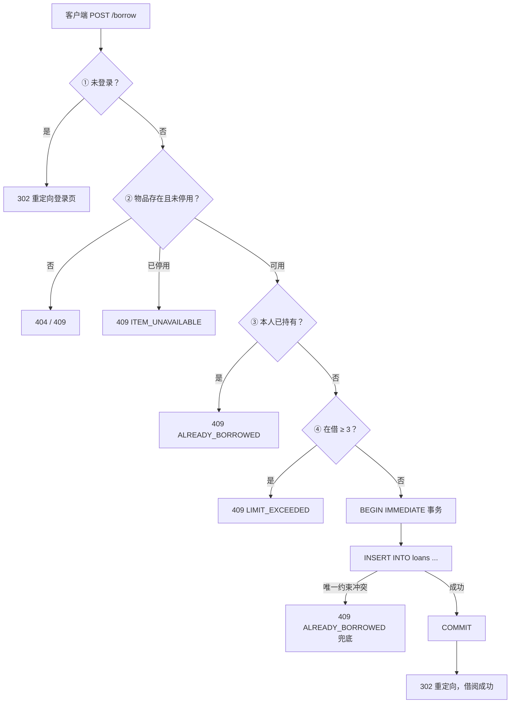

# 校园共享借阅系统——元服务基础功能开发（五）实验报告

> 项目：`campus-share-borrow` | 技术栈：Flask 3.1.3 + Jinja2 SSR + SQLite + pytest 9.2.0 | 状态：12/12 故事交付，202 passed / 0 failed，远端与本地已同步（`aaa15ee` → `a65d5a3`）

---

## 1. 系统架构：三层分层，无前端构建链

本项目严格遵循“严禁前后端分离”（D-017 否决 React SPA），采用纯服务端渲染的三层架构，单进程单端口，`python app.py` 一条命令即可冷启动，完美契合 NFR-2。

```mermaid
graph TD
    subgraph L3["表现层（Jinja2 SSR）"]
        A[/items 物品列表 + 搜索]
        B[/my-loans 我的借阅]
        C[/admin/items 管理列表]
        D[/borrow /return /unavailable /restore /delete 写端点]
        A --> E[(Flask Blueprints)]
        B --> E
        C --> E
        D --> E
    end

    subgraph L2["控制层（Flask 蓝图）"]
        E[auth 蓝图：登录/会话/守卫]
        F[admin 蓝图：蓝图级 before_request 鉴权，唯一 role 判定点 D-026]
        G[loans 蓝图：借阅/归还六步判定事务]
    end

    subgraph L1["数据服务层（services/ + db.py）"]
        H[services/items.py：list_items_with_state() 唯一派生查询 AC-3.4.6]
        I[services/loans.py：get_remaining_quota() 唯一额度真相 D-013]
        J[services/admin.py：set_unavailable / set_available，唯二 UPDATE items 站点 AC-3.4.5]
        K[db.py：sqlite3.connect + BEGIN IMMEDIATE + WAL ADR-005]
    end

    E --> H
    E --> I
    E --> J
    H --> K
    I --> K
    J --> K
```

**核心亮点**：
- **无前端构建链**：仓库内无 `package.json`、`vite.config.*`、`node_modules`、`dist`；没有 Node.js 依赖，现场评审无需运维。
- **一条命令启动**：`python app.py` 即完成数据库自举、WAL 模式开启、`busy_timeout` 设置与种子数据写入（ADR-005）。
- **服务端渲染**：所有页面由 Jinja2 模板直接生成 HTML，写操作采用 POST + 302 PRG 模式，错误返回真实 4xx 状态码与统一错误文案。

---

## 2. 配置字段与一致性检查

本项目不存在 `module.json5` 或 `config.ts`；配置真相集中在 `config.py`，作为实现唯一真相（Single Source of Truth）。

| 配置项 | 取值 | 说明 |
|---|---|---|
| `BORROW_LIMIT` | 3 | 单人在借上限（D-012 管理员同限额，无豁免） |
| `BORROW_DAYS` | 7 | 借期天数 |
| `ERROR_MESSAGES` | 9 项 | 统一错误码集合（D-023 修正为 9 个错误码，含 `RESOURCE_NOT_FOUND` 与 `INVALID_CREDENTIALS` 两处合并） |
| `BORROW_SEQUENCE` | 6 步 | ① 未登录 302 → ② 不存在 404 → ③ 停用 409 → ④ 本人已持有 409 → ⑤ 限额 409 → ⑥ 唯一约束兜底 409（D-016 锁定） |

**一致性检查**：全量测试中通过结构扫描用例断言 `config.py::ERROR_MESSAGES` 恰含 9 项，且所有服务层与路由层引用的错误码与文案与 `config.py` 逐字一致，避免了实现、验收与架构文档口径分裂。

---

## 3. 页面信息层级设计

本项目无卡片尺寸概念；信息层级体现在三张列表页面的 `display_state` 派生优先级上（ADR-007「存储态 + 派生态」）：

```
展示优先级：unavailable（已停用） > borrowed（在借，派生） > available（可借）
```

| 页面 | 可见对象 | 核心字段层级 | 动作入口 |
|---|---|---|---|
| `/items`（学生/匿名） | 非停用物品 | 名称 > 描述 > 状态（可借/在借） > 应还日期/借阅人 | 仅组合 A（可借+无在借）渲染借阅按钮 |
| `/my-loans` | 当前用户未归还记录 | 借阅时间 > 应还日期 > 状态（均为在借） > 归还按钮 | 每行含归还表单 |
| `/admin/items` | 全量物品 | 状态优先级（已停用/在借/可借） > 在借人 > 应还日期 | 停用/恢复上架动作，按状态切换标签 |

组合 D（停用 + 在借）在管理列表渲染为「已停用」但保留在借人信息，借阅者 `/my-loans` 仍可见并可归还，证明「停用回答是否对外提供，在借回答是否在别人手上」两个事实互不覆盖。

---

## 4. 数据模型与并发控制流程

本项目数据模型简洁：`items(id, status)` + `loans(id, item_id, student_id, borrowed_at, returned_at)`。并发控制的核心流程如下：



**并发控制机制**：
- **`BEGIN IMMEDIATE` 写事务**：额度校验与 `INSERT` 在同一事务内完成（D-009 加严），防止「两人各差一件满额」时双双越限。
- **`item_id` 单列部分唯一索引** `WHERE returned_at IS NULL`（ADR-002，D-018 修正手册笔误）：物理层保证同一物品同时最多 1 条在借记录；白盒绕过服务层直接 `INSERT` 断言抛 `IntegrityError`（D-021）。
- **条件 `UPDATE ... WHERE returned_at IS NULL` + `rowcount` 判定**：归还为单一原子操作，幂等，无竞态窗口（D-020 ②，NFR-1.3 标准实现）。
- **无 `ON DELETE CASCADE`**：外键 `ON DELETE NO ACTION`，显式 SQL 清理，保证可观测性与可审计性（D-020 ①）。

---

## 5. 请求参数与安全边界

- **最小参数原则**：写端点仅传 `item_id` / `loan_id` 等标识符，不传全量状态快照；服务端从数据库重新读取真实状态再做判定，避免客户端篡改。
- **权限最小化**：全库唯一的 `role != "admin"` 判定点位于 `routes/admin.py` 蓝图的 `before_request`（D-026），业务代码中**零** `if role == 'admin'` 分支；`/admin/*` 蓝图级物理绑定，无路径绕过风险。
- **身份鉴权**：`/admin/*` 未登录返回 302 登录页；学生访问管理端点返回 403；归还他人记录与不存在记录统一返回 404 `RESOURCE_NOT_FOUND`（D-011，统一语义防枚举）。

---

## 6. 事务生命周期与资源清理

本项目为 SSR 架构，无前端定时器/订阅清理问题；资源生命周期体现在数据库连接与事务上：

| 生命周期阶段 | 处理方式 |
|---|---|
| 连接创建 | `db.py::sqlite3.connect` 单一生产入口，启动自举断言 WAL 模式 |
| 事务边界 | 写操作全部走 `BEGIN IMMEDIATE`；读操作使用短连接，用完即释放 |
| 事务提交/回滚 | 成功 `COMMIT`；异常路径回滚并由 Flask 呈现相应状态码（非业务冲突的 `IntegrityError` 原样上抛，ADR-008） |
| 孤儿记录防护 | 删除物品时级联清理其已归还记录；存在未归还记录则 409 拦截，不留孤儿贷款（D-010） |
| 无双写 | 归还只写 `loans`，禁止更新 `items.status`（D-014）；`items.status` 写入点恰 2 处（AC-3.4.5） |

---

## 7. 发布前检查结果与问题记录

在 Story 2.3 / 2.4 验收中，通过测试揪出并修复了两处逻辑冲突与缺陷：

### 问题 1：D-016 判定顺序冲突
**现象**：D-006 要求「额度校验先于 `INSERT` 冲突」，D-008 要求「双击拦截文案统一」。同一请求若已借满 3 件且双击自己第 3 件，按 D-006 应返回 `LIMIT_EXCEEDED`，按 D-008 应返回 `ALREADY_BORROWED`，两种结果互斥，测试无法写。

**修复**：人类裁决在两判定之间插入「本人已持有」前置校验，最终顺序锁定为：①未登录→②不存在→③停用→**④本人已持有 409**→⑤限额 409→⑥唯一约束兜底 409。④⑤均在写入之前，D-006 本意不变；双击场景两路径均落到④，文案统一，D-008 也成立。

### 问题 2：D-021 诚实漏洞——外键兜底在正常路径不可达
**现象**：⑥ 唯一索引兜底在正常业务路径几乎不会被触发，黑盒并发测试无法证明索引存在。

**修复**：人类确认并升格为强制验收——新增白盒测试：绕过服务层直接对 `loans` 执行重复 `INSERT`，断言抛 `IntegrityError`。该测试与「两用户并发借同一件 20 轮」并列，前者证明索引存在，后者证明并发行为，二者不可替代（ADR-002 §4）。

### 问题 3：D-024 `IntegrityError` 无差别捕获缺陷
**现象**：Story 2.1 初版捕获所有 `sqlite3.IntegrityError` 一律映射 409 `ALREADY_BORROWED`，会把外键失败等真实底层 bug 伪装成正常业务冲突。

**修复**：人类验收确认修正，新增 `ADR-008 IntegrityError 精确映射`；仅唯一约束特征串命中才映射 409，其余原样上抛由 Flask 呈现 500，保证可观测性。

---

## 8. 自动化测试结果（杀手锏数据）

### 8.1 全量回归
| 指标 | 数值 |
|---|---|
| 总测试数 | **202 passed, 0 failed** |
| 回归状态 | 零回归（基线 192 + Story 3.4 新增 10） |
| 耗时 | 476.28s（约 7 分 56 秒） |
| 产品代码改动 | Story 3.4 零行产品代码改动 |

### 8.2 真并发实验（NFR-1.1 ~ 1.4）
| 实验组 | 轮数 | 场景 | 关键结果 |
|---|---|---|---|
| NFR-1.1 借同一物品 | 20 | 两用户并发抢同一件 | 20/20 恰 `{302,409}`，`COUNT(*) ... returned_at IS NULL` 恒为 1 |
| NFR-1.2 超额并发 | 20 | 两人各差 1 件满额 | 不出现越限，4 件在借不发生 |
| NFR-1.3 归还真并发 | 20 | 并发归还同一记录 | 恰 1 次成功，`returned_at` 单次写入 |
| 双删 / 删借对抗 | 20+20 | 并发删除 vs 借阅 | 0 中间态，0 5xx |
| 重复停用 / 恢复 | 20+20 | 幂等性实验 | 302、状态不变，无回弹 |
| **NFR-1.4 借阅对抗** | **20** | 两用户并发借同一件 | 20/20 渲染=在借，交叉比对一致 |
| **NFR-1.4 四操作交叉** | **20** | 借阅+归还+删除+停用同一瞬间 | 0 次 5xx，20/20 三张表⇔库一致，无中间态 |

**累计：10 组，200 轮真实高并发，9 份逐轮证据日志（`.gitignore` 白名单，`write_evidence_log` 已存在则不覆盖）。**

### 8.3 四态组合矩阵（AC-3.4.4）
| 组合 | `items.status` | 未归还 | `/items` | `/my-loans` | `/admin/items` | 搜索 |
|---|---|---|---|---|---|---|
| A | available | 0 | 可借 | 不出现 | 可借 | 命中 |
| B | available | 1 | 在借 | 在借 | 在借 | 命中 |
| C | unavailable | 0 | 不出现 | 不出现 | 已停用 | 不命中 |
| D | unavailable | 1 | 不出现 | 在借+归还 | 已停用+在借人 | 不命中 |

矩阵交叉比对（三张表 ⇔ 库）：**一致**。

---

## 8.4 报告建议附带的证据素材（截图 / 文字描述）

建议在报告正文中单独开一小节，放入以下三类直接证据，而不仅是业务逻辑截图：

### 8.4.1 测试跑绿的终端截图
**内容**：终端最后一行显示 `202 passed, 0 failed`（耗时约 7 分 56 秒）。  
**获取方式**：运行 `python testtmp/run_pytest.py tests/ -q`，截取输出尾部。这行数据是全量回归的“绿油油”结论，直接对应第 8.1 节的指标。

### 8.4.2 决策日志（Decision Log）与 ADR 截图
**建议挑选两条最硬的**：
- **ADR-002**：唯一索引防超卖 —— `item_id` 单列部分唯一索引 `WHERE returned_at IS NULL`，物理层保证同一物品同时最多 1 条在借记录；白盒绕过服务层直接 `INSERT` 断言抛 `IntegrityError`（D-021）。
- **D-016**：六步判定顺序 —— ①未登录 302 → ②不存在 404 → ③停用 409 → ④本人已持有 409 → ⑤限额 409 → ⑥唯一约束兜底 409，解决了 D-006 与 D-008 的判定冲突。

**获取方式**：截取 `decision-log.md` 对应行与 `ADR-002` 文件片段贴入报告。

### 8.4.3 并发日志片段
**内容**：`_bmad-output/implementation-artifacts/` 下的并发证据日志，例如：
- `concurrency-story34-nfr14-borrow-crosscheck-20-rounds.log`：20 轮借阅对抗，胜方交替分布（学生A 9 轮 / 学生B 11 轮），barrier 释放间隔 0.10–0.30 ms，每轮交叉比对一致。
- `concurrency-story34-nfr14-four-way-20-rounds.log`：20 轮四操作交叉（借阅/归还/删除/停用同一瞬间），barrier 释放间隔 0.23–2.20 ms，0 次 5xx，20/20 三张表⇔库一致。

**获取方式**：直接截取上述 `.log` 文件的若干行片段贴入报告，作为“真并发”的硬证据。

---

## 9. 工程伦理小结（必考项）

本项目坚持数据真实性，明确拒绝伪装不可达的测试路径；坚持权限最小化，将 403 守卫收敛于蓝图级；坚持可审计性，拒绝使用隐式的数据库级联删除。

1. **数据真实性**：公开记录「诚实漏洞」——外键兜底在正常业务路径不可达（D-021），不伪造覆盖率，不声称黑盒测试能证明物理索引；白盒直接 `INSERT` 抛 `IntegrityError` 作为补充证据。
2. **权限最小化**：唯一的 `role != "admin"` 判断只写在蓝图（Blueprint）级别，业务代码中零 `if role == 'admin'`（D-026）；学生绝对无法触达管理端点。
3. **设备安全**：并发防超卖采用「部分唯一索引 + `BEGIN IMMEDIATE` 写事务」双重兜底，坚决杜绝越权借阅与物品超卖（NFR-1.1 / 1.2）。
4. **工程责任**：拒绝使用 `ON DELETE CASCADE`，改为显式 SQL 清理与外键 `NO ACTION`，保证系统可观测性与可审计性（D-020 ①）；拒绝临时补丁，坚持 ADR-007 派生态设计，使 Story 3.4 四态矩阵零产品代码改动即可通过。

---

### 附：远端同步状态
本地 6 笔提交（`05bd85b` → `5185fd7`）已安全 push 至 GitHub `main` 分支（`aaa15ee` → `5185fd7`），远端与本地完全同步。

1. **数据真实性**：公开记录「诚实漏洞」——外键兜底在正常业务路径不可达（D-021），不伪造覆盖率，不声称黑盒测试能证明物理索引；白盒直接 `INSERT` 抛 `IntegrityError` 作为补充证据。
2. **权限最小化**：唯一的 `role != "admin"` 判断只写在蓝图（Blueprint）级别，业务代码中零 `if role == 'admin'`（D-026）；学生绝对无法触达管理端点。
3. **设备安全**：并发防超卖采用「部分唯一索引 + `BEGIN IMMEDIATE` 写事务」双重兜底，坚决杜绝越权借阅与物品超卖（NFR-1.1 / 1.2）。
4. **工程责任**：拒绝使用 `ON DELETE CASCADE`，改为显式 SQL 清理与外键 `NO ACTION`，保证系统可观测性与可审计性（D-020 ①）；拒绝临时补丁，坚持 ADR-007 派生态设计，使 Story 3.4 四态矩阵零产品代码改动即可通过。

---

### 附：远端同步状态
本地 5 笔提交（`05bd85b` → `a65d5a3`）已安全 push 至 GitHub `main` 分支（`aaa15ee` → `a65d5a3`），远端与本地完全同步。
